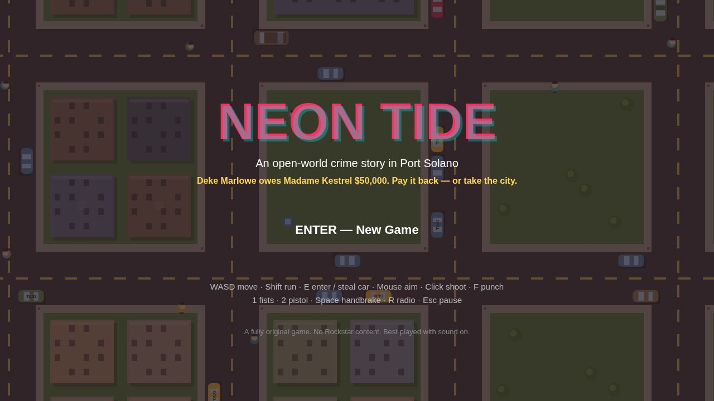
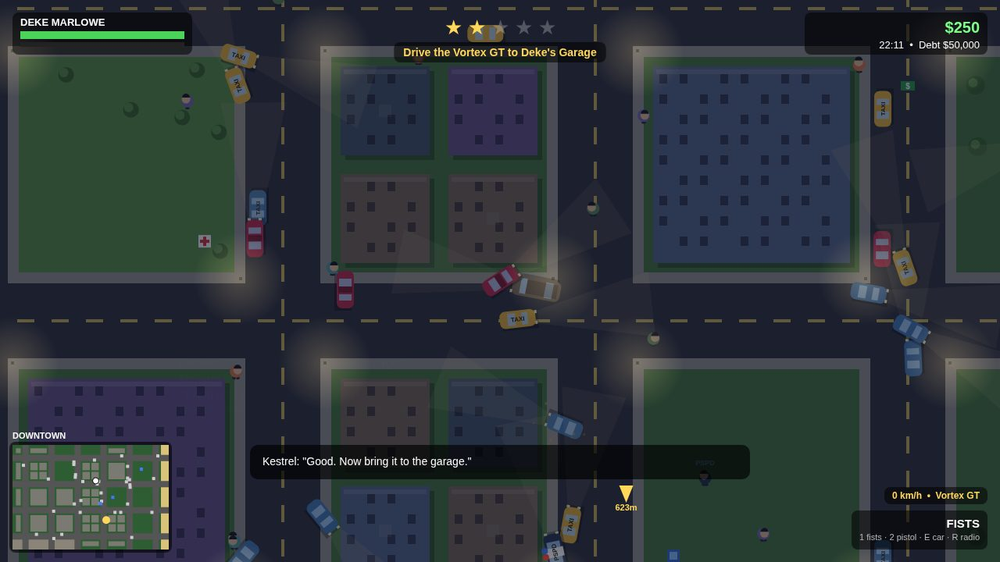
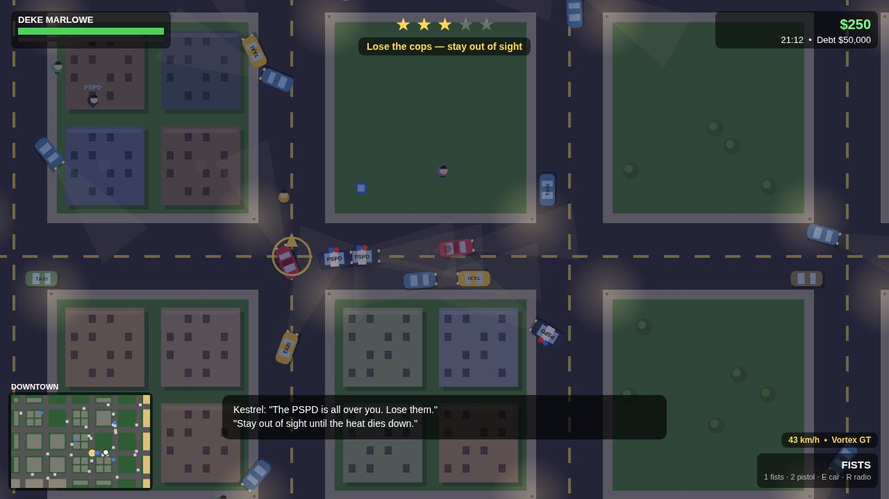
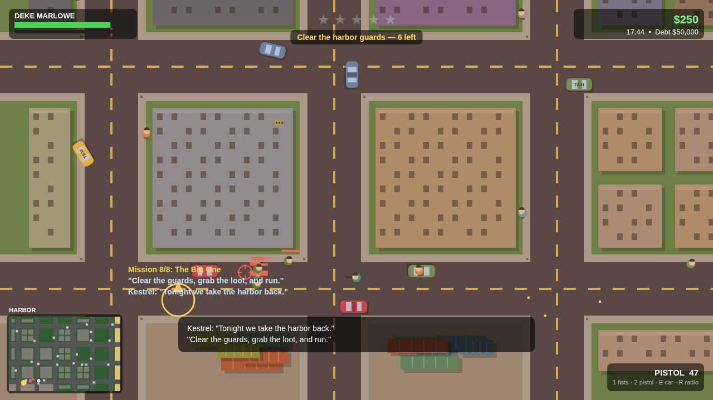

# NEON TIDE — Open-World Crime in Port Solano


An entry for the [gta6-01 bounty on make.fun](https://make.fun/bounty/gta6-01) — build the most complete open-world crime game you can, in the spirit of GTA 6. Play it on [make.fun](https://make.fun).

## The game

**NEON TIDE** is a top-down 2D open-world crime game set in Port Solano, a fictional coastal city. You are **Deke Marlowe**, a getaway driver back in town owing **$50,000** to Madame Kestrel, the harbor crime boss. Pay the debt mission by mission — then take the harbor back from the rival Tide Rats gang.

## What's in the city

- **A living city to walk** — five districts (Downtown, Harbor, Beachfront, Old Town, Suburbs) on a road grid, with buildings, parks, the beach and the docks. Walk with WASD, run with Shift.
- **Five cars to drive and steal** — sedan, taxi, sport, truck and police cruiser, each with its own speed, acceleration and handling. Press **E** to get in; stealing an occupied car makes its driver flee and draws the law.
- **Traffic and pedestrians** — AI cars follow the roads and turn at intersections; pedestrians walk the sidewalks and run from gunfire and speeding cars.
- **Wanted level 0–5 stars** — theft, assault, killing and reckless driving raise the heat. Foot cops and cruisers chase you, roadblocks appear at 3 stars, and getting caught means **BUSTED** while dying means **WASTED** — both cost you money and send you to the station or the hospital.
- **8 story missions** — from "Welcome Back" to the harbor heist finale "The Big One", with markers, waypoint arrows, timers, dialogue, fail-and-retry and cash rewards.
- **Combat** — fists (**F**) and a pistol (mouse aim, click to shoot, **1**/**2** to switch weapons), gang enemies who shoot back, health and armor pickups, cash and ammo drops.
- **HUD + minimap** — health/armor, cash, wanted stars, weapon/ammo, the clock, the objective tracker and a live minimap with blips for you, cars, cops, enemies and the mission.
- **Start screen, pause and saving** — title screen with New Game / Continue, **Esc** to pause, progress saved to localStorage (money, missions, position, wanted).
- **Polish** — a full day/night cycle with sunset and headlights at night, exhaust and crash particles, skid marks, screen shake, three procedural radio stations and sound effects, all synthesized with WebAudio. No audio files, no network requests — the game is fully offline.

## Screenshots

| | |
| --- | --- |
|  |  |
|  |  |

1. **Title screen** — NEON TIDE over Port Solano at sunset.
2. **Night drive** — the stolen Vortex GT in Downtown, 2 wanted stars, traffic and the minimap.
3. **Police chase** — 3 stars, PSPD cruisers on the tail.
4. **Harbor heist** — mission 8, "The Big One": Deke with a pistol against the harbor guards.

## Controls

| Key | Action |
| --- | --- |
| WASD / arrows | Walk / drive |
| Shift | Run |
| E | Enter / steal a car, exit a car |
| Mouse + click | Aim / shoot pistol |
| F | Punch |
| 1 / 2 | Fists / pistol |
| Space | Handbrake |
| R | Radio on/off (Q cycles station) |
| M | Mute |
| Esc | Pause |

## Play it

```sh
node serve.ts
```

Then open <http://localhost:8080> in desktop Chrome. The game is plain static files under `game/` — no build step, no network requests.

The four screenshots in `screenshots/` are real renders of the game, taken by the deterministic autopilot in `game/src/shots.js`: open `?shot=start|drive|chase|mission&seed=1` and the game stages that scene, plays it forward, and raises `window.__shotReady` when the frame is ready to capture.

## Layout

```
main.ts            entrypoint: copies game/ + screenshots/ to /output, writes dossier.json
serve.ts           tiny static server for local play (:8080)
shots.json         the four screenshot definitions
game/
  index.html       loads game/src/main.js
  src/
    config.js      tuning constants, car types, districts, radio stations
    random.js      seeded RNG + math helpers
    input.js       keyboard + mouse state (real and autopilot-driven)
    world.js       city generation, roads, buildings, collision
    main.js        boot, game loop, menus, save/load
    render.js      city, cars, people, lighting, HUD, minimap, screens
    entities.js    player, pedestrians, gang enemies, pickups, car physics
    traffic.js     ambient traffic + parked cars
    police.js      wanted level, cruisers, foot cops, roadblocks, busted/wasted
    missions.js    the 8-mission story, dialogue, rewards
    combat.js      bullets, hits, damage
    audio.js       procedural WebAudio SFX + radio
    particles.js   exhaust, sparks, muzzle flash, skid marks, screen shake
    shots.js       deterministic autopilot for the four screenshots
screenshots/       1-start.jpg 2-drive.jpg 3-chase.jpg 4-mission.jpg
```

## Originality

Everything in NEON TIDE is original: the city of Port Solano, its people, its cars, its story and its music. Nothing from Rockstar Games' Grand Theft Auto series or any other commercial game — no names, logos, characters, map, art or music from them.

## License

MIT — see [LICENSE](LICENSE).
